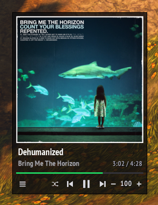
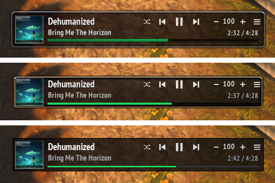
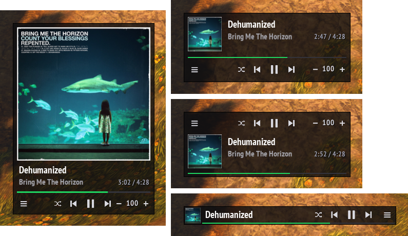
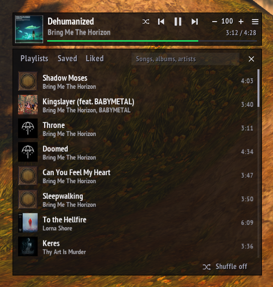
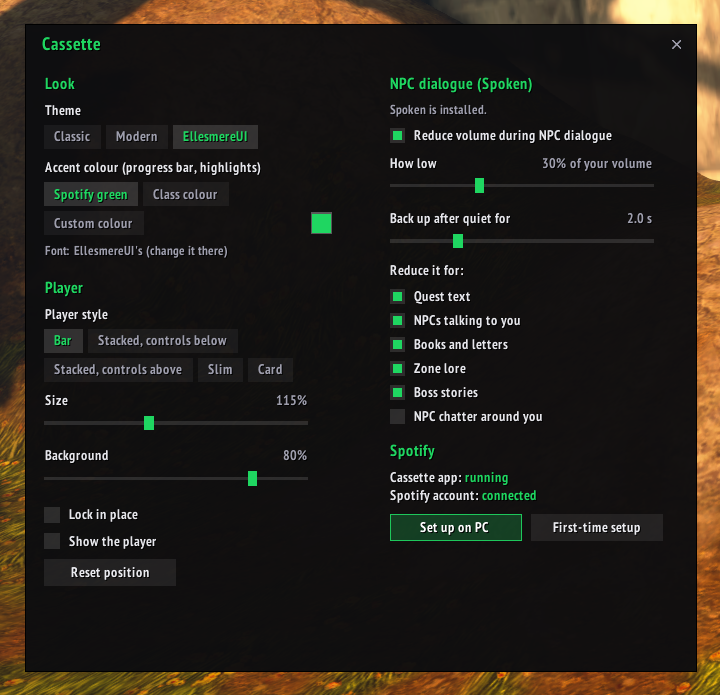
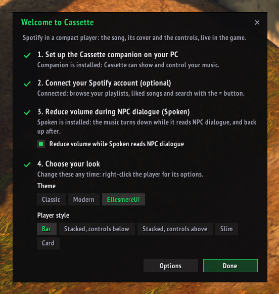

# Cassette

**Control Spotify from inside World of Warcraft.** A compact player with the song that's
playing, its cover, a live progress bar and the controls, right in your UI. It can also turn
your music down while the [Spoken](https://www.curseforge.com/wow/addons/spoken) addon reads
NPC dialogue.

Made for **WoW Forever**. Windows only.

## Features

- **The player:** song, artist and cover, updated the moment the song changes, with play/pause,
  previous, next, shuffle and volume. Five layouts (bar, stacked with the controls below, stacked with them above, slim and card) and three themes:
  Classic, Modern and EllesmereUI.
- **The browser** (the ☰ button): your playlists, playlists you've saved, liked songs, and search
  for songs, albums and artists. Lists scroll; the song that's playing shows in your accent colour.
- **Quieter during dialogue:** with Spoken installed, Spotify turns down while it reads to you, and
  stays down until it's finished, even if you walk away.
- **Settings:** right-click the player, or type `/cassette options`.
- **Keeps itself up to date:** when there's a new version of the app, the game and the tray say
  so, and one click installs it.

## Screenshots

**Three themes:** Classic, Modern and EllesmereUI.

**Five layouts:** bar (above), card, stacked with the controls below or above, and slim.

**Search** for songs, albums and artists, and play them from the list.

**Options**, and the **first-time setup** that walks new players through it.

 

## How it works (and why there's an app)

WoW addons can't talk to other programs, so Cassette comes in two parts:

1. **The addon** draws the player in game.
2. **The Cassette app** runs quietly in your system tray. It talks to Spotify on your PC and
   hands the song, cover and lists to the addon. The addon passes your clicks back by drawing a
   thin line of coloured pixels in the top-left corner of the screen, which the app reads.

The app doesn't read or change the game's memory, inject anything, or press keys in the game.

## Install

1. Download **Cassette-Setup.exe** from the [Releases](../../releases) page and run it.
2. **Windows will probably show a blue "Windows protected your PC" screen.** That's expected:
   click **More info**, then **Run anyway**. (See below for why.)
3. The installer puts Cassette in your Start menu and can start it with Windows. It runs quietly
   in the system tray.
4. The app finds WoW Forever and installs the addon if you don't have it yet. You can also get
   the addon from CurseForge or Wago.
5. Start WoW, or type `/reload` if it's already open. A short setup window walks you through the rest.

To remove Cassette, uninstall it from Windows Settings > Apps like any other program.

### Updates

The app checks this page for a new version when it starts and twice a day. When there is one,
it asks if you'd like to update now, and Cassette says so in game too: install it any time with
**Update app** in the options (or `/cassette update`, or **Update** in the tray icon's menu). The app downloads it, checks it
against the checksum GitHub lists, installs it and restarts, while your music and the game carry
on. Update the addon from CurseForge or Wago as usual.

Version 0.1.0 can't update itself: install 0.1.1 or newer by hand once, and it's automatic
from then on. To turn the checks off, set `"check_updates": false` in
`%LOCALAPPDATA%\Cassette\config.json`.

### About the "Windows protected your PC" warning

Windows shows that screen for any app that isn't signed with a paid code-signing certificate, or
that it hasn't seen many people download yet. It isn't a sign that anything is wrong with the file.
Cassette is free, so it isn't signed: a certificate costs money every year.

If you'd like to check before running it:

- **All its code is public.** Everything is in this repository, and each release is built from it.
- **Check the download is the real one.** Every release lists its installer's SHA-256 checksum.
  In PowerShell, run `Get-FileHash "$env:USERPROFILE\Downloads\Cassette-Setup-0.1.0.exe"` (with
  the version you downloaded) and compare the long number with the one on the release page.
- **What it does on your PC.** It installs into your own user folder, with no admin rights
  needed. It reads the song from Windows' media controls and a thin strip of pixels from the WoW
  window, and writes small files into the Cassette addon's folder. It never touches the game's
  memory or sends keypresses.

Some antivirus programs are wary of new, unsigned apps too. If yours stops the installer, you can
report the file to them as a false positive, or ask on the Issues page.

## Spotify

- **Play, pause, skip and volume** work with any Spotify account, through Windows' own media
  controls. No sign-in is needed.
- **Playlists, liked songs and search** need **Spotify Premium** and a one-time connection.
  Spotify asks every player to create their own (free) developer app for this. The *Connect
  Spotify* window in the Cassette app walks you through it in about two minutes.

Your Spotify sign-in is stored only on your PC, encrypted with your Windows account. Cassette
talks only to Spotify, and to GitHub to look for new versions of the app. It sends nothing about
you anywhere.

## Commands

| Command | What it does |
|---|---|
| `/cassette` | show or hide the player |
| `/cassette options` | settings |
| `/cassette setup` | the first-time setup again |
| `/cassette update` | install a new version of the app, when there is one |
| `/cassette duck 30` | how low the music goes during dialogue (% of your volume) |
| `/cassette status` | connection details, for troubleshooting |

## Building from source

- **Addon:** the `addon/Cassette` folder. Copy it into `_forever_\Interface\AddOns`.
- **App:** Python 3.12. `companion\cassette.py` is the app; `tools\build_app.py` builds
  `Cassette.exe` and the installer (needs PyInstaller and Inno Setup 7).
- **Tests:** `tools\luatest\run_all.py` (the addon, against a WoW stand-in), plus
  `tools\test_browse.py`, `tools\sim_protocol.py` and `tools\test_duck.py`.

## Licence

Copyright (C) 2026 ghilliepng. All rights reserved. Cassette is free to download and use, and
its code is public so you can see exactly what it does, but it may not be copied, re-uploaded,
modified or sold without permission. See [LICENSE](LICENSE) for the details.

The app bundles some third-party libraries, each under its own licence: see
[THIRD-PARTY-NOTICES.md](THIRD-PARTY-NOTICES.md).

Not affiliated with Spotify or Blizzard Entertainment.
